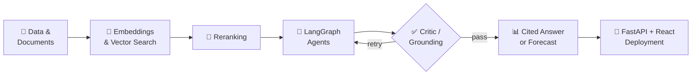

<div align="center">


<a href="https://amruthssharmaportfolio.netlify.app/">
  
</a>

<br/><br/>

<a href="https://amruthssharmaportfolio.netlify.app/"></a>
<a href="https://linkedin.com/in/amruthssss"></a>
<a href="mailto:amruths604@gmail.com"></a>
<a href="https://github.com/amruthssss"></a>


<br/><br/>

<sub>📍 Bengaluru, India &nbsp;·&nbsp; 🎓 B.E. CSE, Sai Vidya Institute of Technology &nbsp;·&nbsp; CGPA 8.2</sub>

</div>


<h2 align="center">✨ About Me</h2>

<div align="center">
<table>
<tr>
<td width="55%" valign="middle">

```python
class Amruth:
    role   = "AI / ML Engineer"
    focus  = ["Generative AI", "RAG", "AI Agents",
              "Forecasting", "Computer Vision"]
    stack  = ["Python", "FastAPI", "LangGraph",
              "PyTorch", "React", "PostgreSQL"]
    motto  = "Learn. Build. Improve. Repeat."

    def now(self):
        return "Building agentic AI systems 🤖"
```

</td>
<td width="45%" valign="middle">

I'm a Computer Science graduate who enjoys building **intelligent systems that actually work** — from retrieval-augmented assistants and multi-agent workflows to forecasting platforms and real-time vision pipelines.

I care about **grounded, testable AI**: validated evidence, critic loops, measurable metrics.

</td>
</tr>
</table>
</div>


<h2 align="center">🧰 Tech Stack</h2>

<div align="center">
<table>
<tr>
<td align="right" width="22%"><b>Languages</b></td>
<td> &nbsp;</td>
</tr>
<tr>
<td align="right"><b>AI / ML</b></td>
<td></td>
</tr>
<tr>
<td align="right"><b>Generative AI</b></td>
<td>


</td>
</tr>
<tr>
<td align="right"><b>Backend & Web</b></td>
<td></td>
</tr>
<tr>
<td align="right"><b>Databases</b></td>
<td></td>
</tr>
<tr>
<td align="right"><b>Tools & Cloud</b></td>
<td></td>
</tr>
</table>
</div>

<br/>

<div align="center"><sub>RAG · Agentic / Hybrid RAG · Embeddings · Vector Search · Reranking · Prompt Engineering · Time-Series Forecasting · XGBoost · Prophet · LSTM · CI/CD · REST APIs · n8n · Streamlit</sub></div>


<h2 align="center">🧬 How I Build AI Systems</h2>




<h2 align="center">💼 Experience</h2>

<div align="center">
<table>
<tr>
<td width="24%" align="center" valign="top">
<b>Android Developer Intern</b><br/>
MindMatrix.io<br/>
<sub>Bengaluru</sub><br/><br/>
<code>Feb 2026 – May 2026</code>
</td>
<td width="76%" valign="top">

- Built **Akshara-Deepa**, a full-stack Android SSLC learning app with Capacitor.js, Firebase & Google Sign-In
- Integrated **Gemini 1.5 Flash** for adaptive quizzes, automated answer evaluation, a study planner and an AI tutor
- Designed **Strength Map** radar charts (mastery, accuracy, streaks) with real-time Firestore sync
- Owned UI/UX, testing, debugging and Gradle release builds — **100% crash-free launch** on Google Play internal testing

</td>
</tr>
</table>
</div>


<h2 align="center">🚀 Featured Projects</h2>

<div align="center">
<table>
<tr>
<td width="50%" valign="top">

### 🛰️ [Orbit AI Platform](https://github.com/amruthssss/Orbit_AI)
Full-stack AI platform with Gemini chat, **RAG**, agents, tool calling and LLM evaluation. Embeddings → vector retrieval → **reranking** for cited answers, plus Tavily web research.

   

</td>
<td width="50%" valign="top">

### 📦 [StockWise — Stock_AI](https://github.com/amruthssss/Stock_AI)
Retail inventory intelligence: forecasting, stockout / overstock / expiry risk and a **4-agent LangGraph** workflow with local Ollama/Qwen. Deterministic analytics stay authoritative; the LLM only explains validated evidence.

   

</td>
</tr>
<tr>
<td width="50%" valign="top">

### 🚀 [LaunchPad AI](https://github.com/amruthssss/LaunchPad-AI)
Multi-agent platform for startup market research, architecture and revenue forecasts. A self-correcting **Critic Agent** (0.0–1.0 scoring) routes retries; grounded with RAG. Real-time results over WebSockets.

   

</td>
<td width="50%" valign="top">

### 🎥 [Multimodal Surveillance](https://github.com/amruthssss/multimodal-Surveillance)
Real-time detection of fire, smoke, accidents, explosions and gunshots from video + audio, fully local. Temporal confirmation, dedup, email/SMS alerts, adaptive thresholds and a **90%+ precision gate**.

   

</td>
</tr>
<tr>
<td width="50%" valign="top">

### 📚 [arXiv Research Copilot](https://github.com/amruthssss/Autonomous_arXiv_Assessment)
Research assistant for arXiv discovery, PDF processing and grounded Q&A. Stateful LangGraph workflow → chunking → local embeddings → Gemini answers with source metadata.

  

</td>
<td width="50%" valign="top">

### ⚡ [EV Charging Analytics](https://github.com/amruthssss/ev_charging_analysis)
Demand forecasting and clustering across **457 stations**. K-Means + PCA reveal **4 behavioral personas**; Prophet, Gradient Boosting and Random Forest drive predictions; Plotly dashboards on Streamlit.

  

</td>
</tr>
<tr>
<td colspan="2" valign="top">

### 🎙️ [Spoken Keyword Spotting](https://github.com/amruthssss/keySpotting/tree/master/Spoken-Keyword-Spotting)
CNN-SVM audio classifier with MFCC features for edge devices (10 keyword classes). **INT8 quantization → 75% smaller model, 40% lower latency, 0.98 F1.**  
  

</td>
</tr>
</table>
</div>


<h2 align="center">📊 GitHub Activity</h2>

<div align="center">


<br/>


<br/>


<br/>


</div>


<h2 align="center">🎓 Education & Certifications</h2>

<div align="center">
<table>
<tr>
<td colspan="3" align="center">
<b>B.E. Computer Science & Engineering</b> — Sai Vidya Institute of Technology, Bengaluru<br/>
<sub>2022 – 2026 &nbsp;·&nbsp; CGPA 8.2 / 10 &nbsp;·&nbsp; DBMS · OOP · Machine Learning · AI · Data Analytics</sub>
</td>
</tr>
<tr>
<td width="34%" align="center" valign="top">🤖<br/><b>Google AI Professional Certificate</b><br/><sub>Google / Coursera · 2026</sub></td>
<td width="33%" align="center" valign="top">📊<br/><b>Data Analytics with Python</b><br/><sub>NPTEL, IIT Roorkee · 2026</sub></td>
<td width="33%" align="center" valign="top">🧠<br/><b>AI Fundamentals</b><br/><sub>IBM SkillsBuild · 2025</sub></td>
</tr>
<tr>
<td align="center" valign="top">☁️<br/><b>Networking & Cloud Computing</b><br/><sub>Microsoft / Coursera · 2025</sub></td>
<td align="center" valign="top">🐍<br/><b>Python Data Analysis</b><br/><sub>Rice University / Coursera · 2025</sub></td>
<td align="center" valign="top">🔗<br/><b>More credentials</b><br/><sub><a href="https://linkedin.com/in/amruthssss">View on LinkedIn</a></sub></td>
</tr>
</table>
</div>


<div align="center">

<h2>🤝 Let's Build Something Intelligent</h2>

<a href="mailto:amruths604@gmail.com"></a>
<a href="https://linkedin.com/in/amruthssss"></a>
<a href="https://amruthssharmaportfolio.netlify.app/"></a>

<br/>


</div>
