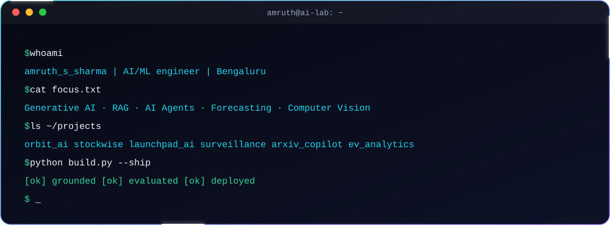
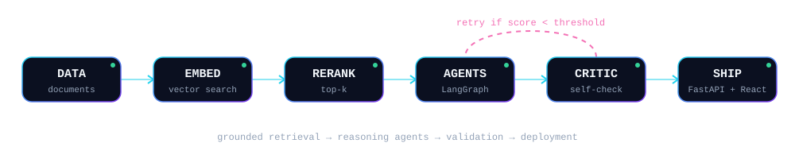
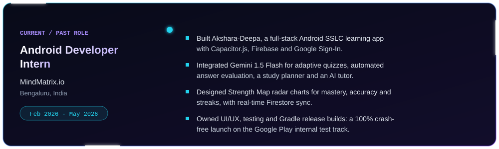
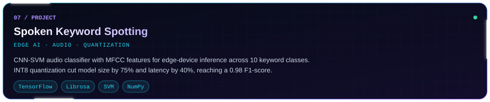
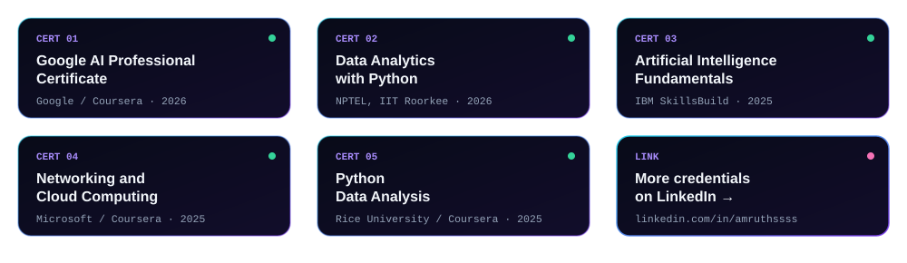

 

  

 

I'm a Computer Science graduate (B.E., Sai Vidya Institute of Technology, CGPA 8.2) who builds <b>grounded, testable AI</b>: retrieval-augmented assistants, multi-agent workflows, forecasting platforms and real-time vision pipelines.

  

<table>
<tr><td align="right"><b>Languages</b></td><td align="left"> </td></tr>
<tr><td align="right"><b>AI / ML</b></td><td align="left"></td></tr>
<tr><td align="right"><b>Generative AI</b></td><td align="left">

</td></tr>
<tr><td align="right"><b>Backend & Web</b></td><td align="left"></td></tr>
<tr><td align="right"><b>Databases</b></td><td align="left"></td></tr>
<tr><td align="right"><b>Tools & Cloud</b></td><td align="left"></td></tr>
</table>

RAG · Agentic / Hybrid RAG · Embeddings · Reranking · Prompt Engineering · Time-Series Forecasting · XGBoost · Prophet · LSTM · CI/CD · n8n · Streamlit

  

 

 

<table>
<tr>
<td width="50%"></td>
<td width="50%"></td>
</tr>
<tr>
<td width="50%"></td>
<td width="50%"></td>
</tr>
<tr>
<td width="50%"></td>
<td width="50%"></td>
</tr>
<tr>
<td colspan="2"></td>
</tr>
</table>

 

  

 

