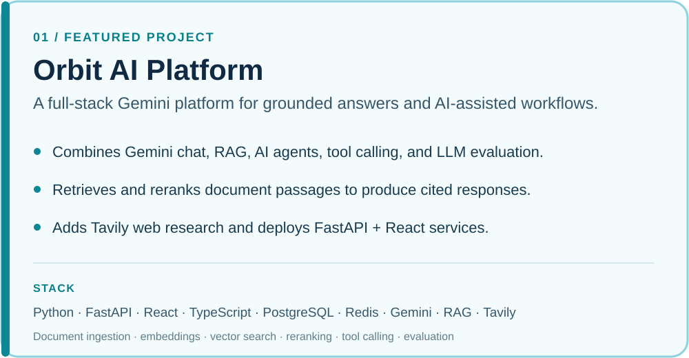
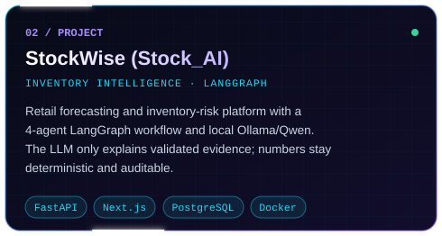
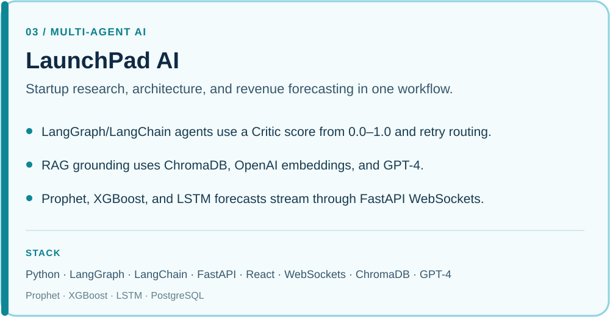
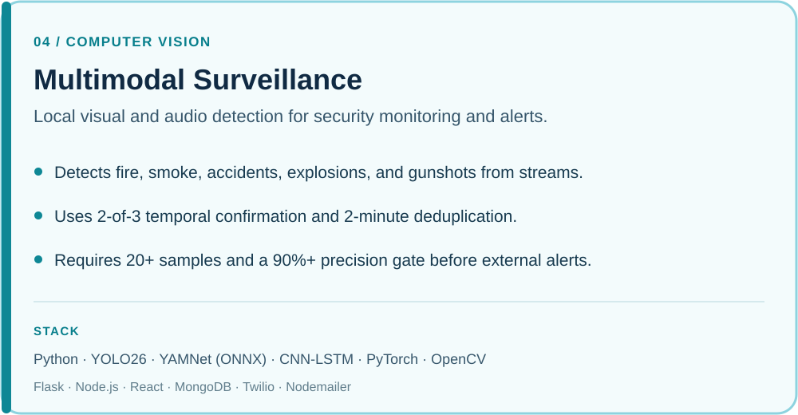
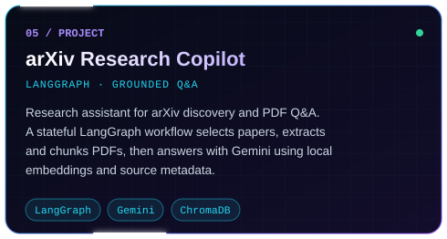
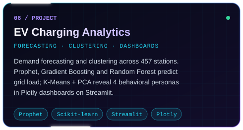

  

  <a href="https://amruthssharmaportfolio.netlify.app/">Portfolio</a> ·
  <a href="https://linkedin.com/in/amruthssss">LinkedIn</a> ·
  <a href="mailto:amruths604@gmail.com">Email</a> ·
  <a href="https://github.com/amruthssss">GitHub</a>

Computer Science graduate based in Bengaluru, building practical AI/ML systems across Generative AI, forecasting, computer vision, and edge audio.

## Featured projects

 <a href="https://github.com/amruthssss/Orbit_AI">View on GitHub ↗</a>

 <a href="https://github.com/amruthssss/Stock_AI">View on GitHub ↗</a>

<table>
  <tr>
    <td width="50%" valign="top"> <a href="https://github.com/amruthssss/LaunchPad-AI">View on GitHub ↗</a></td>
    <td width="50%" valign="top"> <a href="https://github.com/amruthssss/multimodal-Surveillance">View on GitHub ↗</a></td>
  </tr>
  <tr>
    <td width="50%" valign="top"> <a href="https://github.com/amruthssss/Autonomous_arXiv_Assessment">View on GitHub ↗</a></td>
    <td width="50%" valign="top"> <a href="https://github.com/amruthssss/ev_charging_analysis">View on GitHub ↗</a></td>
  </tr>
</table>

<b>More projects</b> · <a href="https://github.com/amruthssss/keySpotting/tree/master/Spoken-Keyword-Spotting">Spoken Keyword Spotting</a> — edge audio classification across 10 keyword classes; INT8 quantization reduced model size by 75% and latency by 40%, with a 0.98 F1-score.

## Tech stack

**Languages:** Python, SQL, C  ·  **AI/ML:** Machine Learning, Deep Learning, NLP, Computer Vision, Transformers, Scikit-learn, XGBoost, Prophet, OpenCV  ·  **Generative AI:** LLMs, RAG, LangChain, AI agents, multi-agent systems, embeddings, vector search, reranking  ·  **Backend & data:** FastAPI, Flask, PostgreSQL, MySQL, MongoDB, SQLite, Redis, ChromaDB  ·  **Tools:** Git, GitHub, CI/CD, REST APIs, GCP, Firebase, n8n, Vercel

## Experience

**Android Developer Intern** · MindMatrix.io, Bengaluru 
Feb 2026 – May 2026

- Developed Akshara-Deepa, an Android SSLC learning app using Capacitor.js, Firebase, and Google Sign-In.
- Integrated Gemini 1.5 Flash for adaptive quizzes, answer evaluation, a study planner, and an AI tutor.
- Built Strength Map radar charts and real-time Firestore sync; owned UI/UX, testing, and release builds.
- Delivered a 100% crash-free launch on the Google Play internal test track.

## Certifications

- Google AI Professional Certificate · Google / Coursera · 2026
- Data Analytics with Python · NPTEL, IIT Roorkee · 2026
- Artificial Intelligence Fundamentals · IBM SkillsBuild · 2025
- Networking and Cloud Computing · Microsoft / Coursera · 2025
- Python Data Analysis · Rice University / Coursera · 2025

## GitHub activity · work highlights

Selected, verifiable outcomes from the project repositories:

- [**EV Charging Analytics**](https://github.com/amruthssss/ev_charging_analysis): forecasting and clustering across 457 stations; identified 4 station personas.
- [**Spoken Keyword Spotting**](https://github.com/amruthssss/keySpotting/tree/master/Spoken-Keyword-Spotting): reduced model size by 75% and latency by 40%; achieved a 0.98 F1-score.
- [**Multimodal Surveillance**](https://github.com/amruthssss/multimodal-Surveillance): added a 20+ sample, 90%+ precision gate before external alerts, with 2-of-3 temporal confirmation and 2-minute deduplication.

## Contact

**Amruth S Sharma** · Bengaluru, India · B.E. Computer Science and Engineering, Sai Vidya Institute of Technology, 2022–2026 · CGPA 8.2/10

[Portfolio](https://amruthssharmaportfolio.netlify.app/) · [LinkedIn](https://linkedin.com/in/amruthssss) · [Email](mailto:amruths604@gmail.com) · [GitHub](https://github.com/amruthssss)
