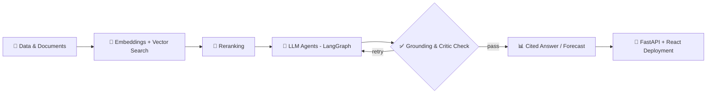

<!-- ===================== HEADER ===================== -->
<div align="center">


<a href="https://amruthssharmaportfolio.netlify.app/">

</a>

<br/>

[](https://amruthssharmaportfolio.netlify.app/)
[](https://linkedin.com/in/amruthssss)
[](mailto:amruths604@gmail.com)
[](https://github.com/amruthssss)


</div>

---

## ⚡ About Me

<table>
<tr>
<td width="58%" valign="top">

```python
class Amruth:
    role     = "AI/ML Engineer"
    based_in = "Bengaluru, India 🇮🇳"
    degree   = "B.E. CSE · SVIT · CGPA 8.2"
    focus    = ["Generative AI", "RAG", "AI Agents",
                "Forecasting", "Computer Vision"]
    stack    = ["Python", "FastAPI", "LangGraph",
                "PyTorch", "React", "PostgreSQL"]
    motto    = "Learn. Build. Improve. Repeat."

    def now(self):
        return "Building agentic AI systems 🤖"
```

</td>
<td width="42%" valign="top">

🎓 **B.E. Computer Science** — Sai Vidya Institute of Technology (2022–2026)

💼 Ex **Android Developer Intern** @ MindMatrix.io

🤖 Projects in **RAG, multi-agent systems, predictive analytics & vision**

🌱 Exploring **Agentic RAG, LLM evaluation & production AI**

</td>
</tr>
</table>

---

## 🧰 Tech Arsenal

<div align="center">

<br/>
<br/>
<br/>
<br/><br/>


</div>

---

## 🧬 How I Build AI Systems



---

## 💼 Experience

<table>
<tr><td>

### 📱 Android Developer Intern — MindMatrix.io, Bengaluru
`Feb 2026 – May 2026`

- Built **Akshara-Deepa**, a full-stack Android SSLC learning app (Capacitor.js, Firebase, Google Sign-In)
- Integrated **Gemini 1.5 Flash** for adaptive quizzes, auto answer evaluation, study planner & AI tutor
- Created **Strength Map** radar charts with real-time Firestore sync
- Owned UI/UX, testing & Gradle release builds → **100% crash-free launch** on Google Play internal test track

</td></tr>
</table>

---

## 🚀 Featured Projects

<div align="center">

<a href="https://github.com/amruthssss/Orbit_AI"></a>
<a href="https://github.com/amruthssss/Stock_AI"></a>
<a href="https://github.com/amruthssss/LaunchPad-AI"></a>
<a href="https://github.com/amruthssss/multimodal-Surveillance"></a>
<a href="https://github.com/amruthssss/Autonomous_arXiv_Assessment"></a>
<a href="https://github.com/amruthssss/ev_charging_analysis"></a>

</div>

<details open>
<summary><b>🛰️ Orbit AI Engineering Platform</b> — RAG · AI Agents · Tool Calling · LLM Evaluation</summary>

- Full-stack Python AI platform: Gemini chat, RAG, agents, tool calling, LLM evaluation
- Ingestion pipeline with Gemini embeddings, vector retrieval & **reranking** for cited answers, plus Tavily web research
- FastAPI + React + PostgreSQL + Redis, deployed on Vercel & Render

</details>

<details>
<summary><b>📦 StockWise (Stock_AI)</b> — Inventory Intelligence · 4-Agent LangGraph · Local LLM</summary>

- Forecasting (LightGBM, XGBoost), stockout / overstock / expiry risk & policy scenarios
- Supervisor + Forecast, Inventory Risk, Decision & BI agents orchestrated with **LangGraph**
- Local **Ollama/Qwen** explanations validated with Pydantic; deterministic analytics stay authoritative
- FastAPI, PostgreSQL + Alembic, Next.js dashboards, Docker Compose

</details>

<details>
<summary><b>🚀 LaunchPad AI</b> — Multi-Agent Startup Research & Forecasting</summary>

- LangGraph + LangChain agents with a self-correcting **Critic Agent** (0.0–1.0 scoring) and retry routing
- RAG with ChromaDB, OpenAI embeddings & GPT-4; revenue forecasts via Prophet, XGBoost & LSTM
- React + FastAPI WebSockets for real-time results

</details>

<details>
<summary><b>🎥 Multimodal Surveillance System</b> — Real-time Fire · Smoke · Accident · Gunshot Detection</summary>

- YOLO26 Nano, CNN-LSTM, YOLO checkpoints & **YAMNet (ONNX)** audio on webcam / RTSP / IP streams, fully local
- 2-of-3 temporal confirmation, 2-min dedup, severity escalation; email (JPEG) + critical-only Twilio SMS
- Operator feedback with adaptive thresholds, live precision/recall/F1 and a **90%+ precision gate**
- Flask + Node.js + React dashboard, MongoDB logging

</details>

<details>
<summary><b>📚 arXiv Research Copilot</b> · <b>⚡ EV Charging Analytics</b> · <b>🎙️ Keyword Spotting</b></summary>

- **arXiv Copilot:** stateful LangGraph workflow → PDF extraction, chunking, local embeddings (ChromaDB) → grounded Gemini answers with sources
- **EV Analytics:** forecasting & clustering across **457 stations**; K-Means + PCA → 4 behavioral personas; Plotly + Streamlit
- **Keyword Spotting:** CNN-SVM + MFCC; INT8 quantization → **-75% size, -40% latency, 0.98 F1** ([repo](https://github.com/amruthssss/keySpotting/tree/master/Spoken-Keyword-Spotting))

</details>

---

## 📊 GitHub Stats

<div align="center">


</div>

### 🐍 Contribution Snake

<div align="center">

</div>

---

## 🏆 Certifications

| | Certificate | Issuer | Year |
|---|---|---|---|
| 🤖 | **Google AI Professional Certificate** | Google / Coursera | 2026 |
| 📊 | **Data Analytics with Python** | NPTEL, IIT Roorkee | 2026 |
| 🧠 | **Artificial Intelligence Fundamentals** | IBM SkillsBuild | 2025 |
| ☁️ | **Networking and Cloud Computing** | Microsoft / Coursera | 2025 |
| 🐍 | **Python Data Analysis** | Rice University / Coursera | 2025 |

👉 Verify all credentials on my [LinkedIn](https://linkedin.com/in/amruthssss)

---

<div align="center">

### 🤝 Let's build something intelligent together

[](mailto:amruths604@gmail.com)
[](https://linkedin.com/in/amruthssss)

**💻 Code • Build • Learn • Repeat 🚀**


</div>
